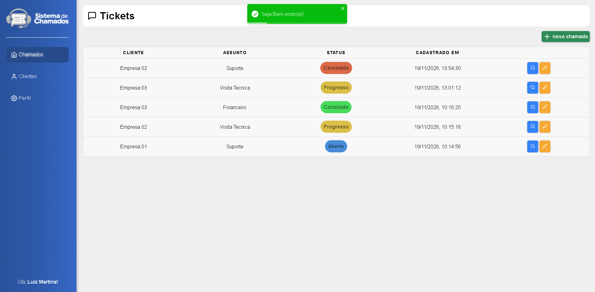
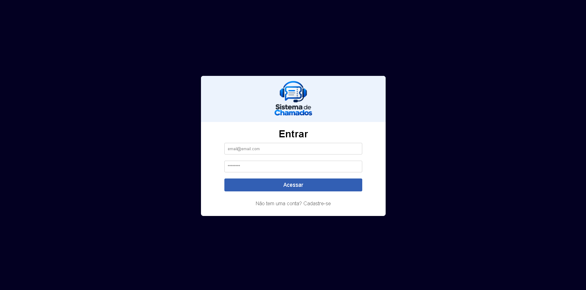
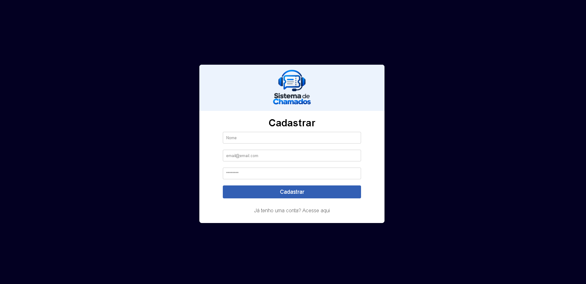
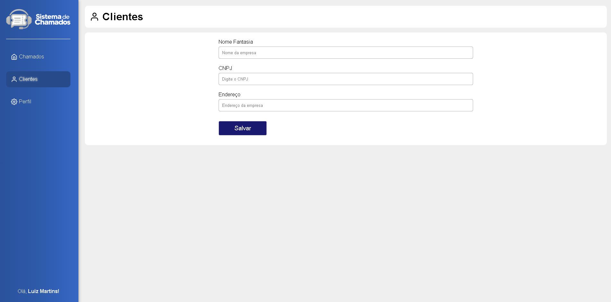
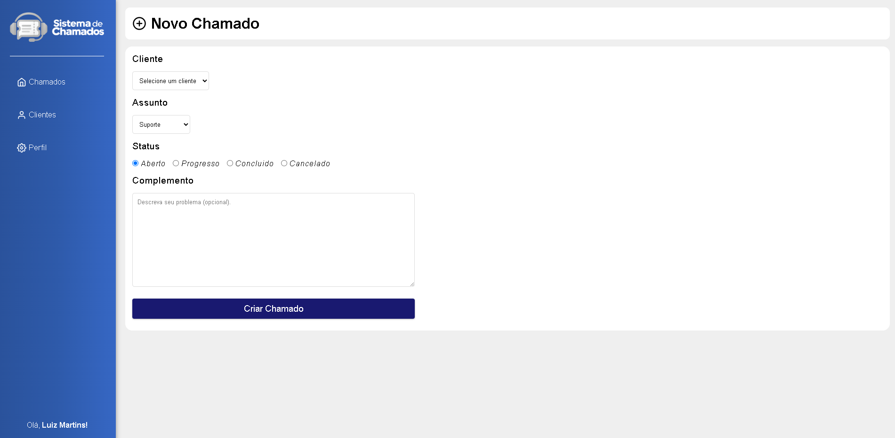
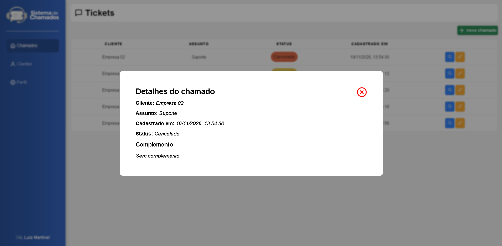
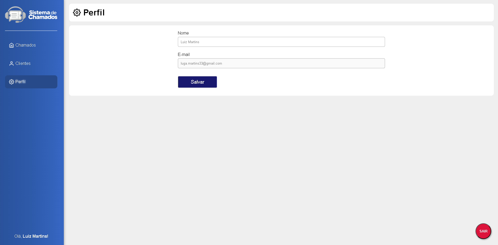
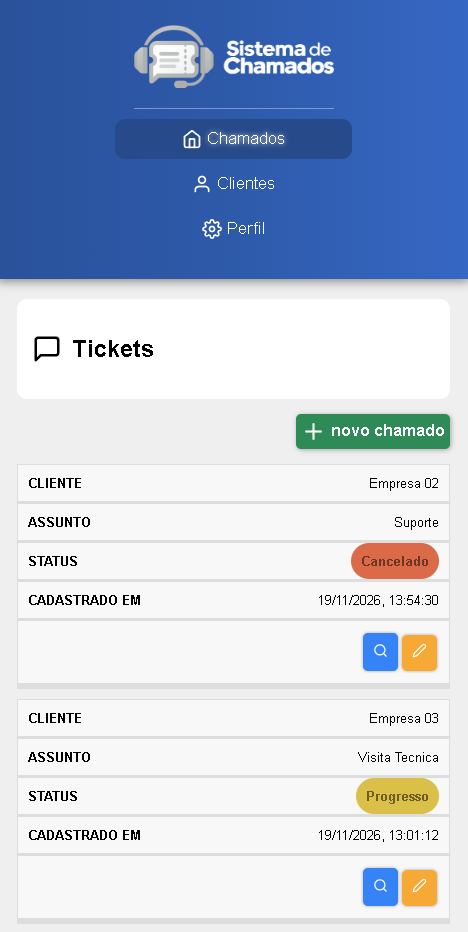
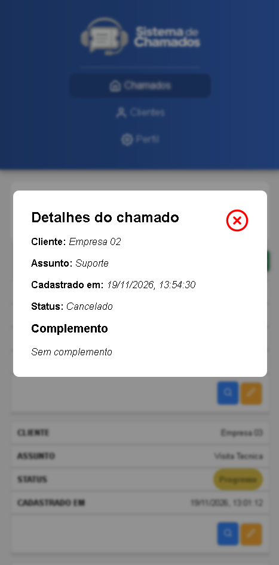

<div align="center">


# Sistema de Chamados

### Plataforma web para gerenciamento de chamados e atendimento a clientes


**[Repositório no GitHub](https://github.com/LuFMartins/projeto-sistema-de-chamados)**

</div>

---

## 📖 Sobre o projeto

O **Sistema de Chamados** é uma aplicação web desenvolvida com React e TypeScript, com o objetivo de facilitar o registro, acompanhamento e gerenciamento de solicitações de atendimento.

O sistema permite cadastrar clientes, registrar chamados, acompanhar seus status, consultar informações detalhadas e editar registros existentes.

A aplicação utiliza **Firebase Authentication** para autenticação de usuários e **Cloud Firestore** para armazenamento dos dados.

O projeto foi desenvolvido como parte dos meus estudos e aprimoramento em desenvolvimento Front-End, com foco na construção de aplicações que utilizam autenticação, gerenciamento de estados, rotas protegidas e integração com banco de dados.

## 🚀 Funcionalidades

### 🔐 Autenticação de usuários

- Cadastro de usuários com nome, e-mail e senha.
- Login utilizando Firebase Authentication.
- Gerenciamento da sessão do usuário.
- Rotas protegidas para usuários autenticados.
- Redirecionamento de usuários conforme o estado da autenticação.
- Encerramento de sessão (logout).

### 🏢 Gerenciamento de clientes

- Cadastro de empresas.
- Armazenamento de nome fantasia, CNPJ e endereço.
- Persistência das informações no Firestore.
- Seleção de clientes cadastrados ao criar chamados.
- Vinculação entre chamados e clientes pelo ID do documento.

### 🎫 Gerenciamento de chamados

- Cadastro de novos chamados.
- Edição de chamados existentes.
- Associação de chamados a clientes.
- Seleção de assunto: Suporte, Visita Técnica ou Financeiro.
- Definição de status: Aberto, Progresso, Concluído ou Cancelado.
- Campo opcional para descrição do problema.
- Registro da data de criação.
- Listagem de chamados ordenados por data.
- Identificação visual dos status por cores.

### 🔎 Consulta e paginação

- Visualização dos chamados em tabela.
- Exibição detalhada de chamados através de um modal.
- Paginação utilizando cursores do Firestore.
- Carregamento incremental com o botão "Carregar mais chamados".
- Tratamento de estados de carregamento e listas vazias.

### 👤 Perfil do usuário

- Visualização das informações da conta.
- Alteração do nome do usuário.
- Atualização dos dados no Firestore.
- Sincronização do nome com o contexto de autenticação.
- Logout.

### 📱 Interface responsiva

- Layout adaptado para desktop e dispositivos móveis.
- Navegação lateral em telas maiores.
- Menu adaptado para telas menores.
- Tabela de chamados reorganizada em dispositivos móveis.
- Modal de detalhes responsivo.
- Feedback visual através de notificações Toast.

---

## 🖼️ Demonstração do sistema

### Dashboard — Gerenciamento de chamados

O Dashboard apresenta os chamados cadastrados, seus respectivos clientes, assuntos, status e datas de criação.



### Autenticação

Telas de login e cadastro de usuários utilizando Firebase Authentication.

<table>
  <tr>
    <td align="center">
      <strong>Login</strong>
    </td>
    <td align="center">
      <strong>Cadastro</strong>
    </td>
  </tr>
  <tr>
    <td>
      
    </td>
    <td>
      
    </td>
  </tr>
</table>

### Cadastro de clientes

Formulário para registrar empresas com nome fantasia, CNPJ e endereço.



### Criação de chamados

Formulário para cadastrar chamados, associar clientes, selecionar assuntos, definir status e adicionar descrições.



### Detalhes do chamado

Visualização das informações completas de um chamado através de um modal.



### Perfil

Área para visualização das informações do usuário e atualização do nome cadastrado.



### Versão mobile

A interface se adapta a dispositivos móveis, reorganizando o menu de navegação, a listagem dos chamados e o modal de detalhes.

<table>
  <tr>
    <td align="center">
      <strong>Dashboard Mobile</strong>
    </td>
    <td align="center">
      <strong>Detalhes do Chamado</strong>
    </td>
  </tr>
  <tr>
    <td align="center">
      
    </td>
    <td align="center">
      
    </td>
  </tr>
</table>

---

## 🛠️ Tecnologias utilizadas

| Tecnologia | Finalidade |
|---|---|
| React | Construção da interface através de componentes |
| TypeScript | Tipagem estática e organização do código |
| Vite | Ambiente de desenvolvimento e build |
| CSS3 | Estilização e responsividade |
| React Router | Gerenciamento de rotas |
| Context API | Compartilhamento dos dados de autenticação |
| Firebase Authentication | Cadastro, login e gerenciamento de sessões |
| Cloud Firestore | Armazenamento de usuários, clientes e chamados |
| React Toastify | Notificações e feedback visual |
| React Icons | Ícones da interface |
| Netlify | Hospedagem e publicação da aplicação |

## 🧠 Conceitos aplicados

Durante o desenvolvimento, foram utilizados conceitos importantes do ecossistema React e do desenvolvimento Front-End:

- Componentização e reutilização de interfaces.
- Hooks `useState`, `useEffect` e `useContext`.
- Criação de hooks personalizados.
- Context API para gerenciamento de autenticação.
- Formulários controlados.
- Tipagem de propriedades, estados e eventos com TypeScript.
- Operações de criação, leitura e atualização no Firestore.
- Consultas com `query()`, `orderBy()` e `limit()`.
- Paginação por cursor com `startAfter()`.
- Tratamento de operações assíncronas com `async/await`.
- Tratamento de erros com `try/catch/finally`.
- Rotas dinâmicas utilizando `useParams()`.
- Proteção de rotas conforme a autenticação.
- Layout responsivo utilizando CSS.

---

## 📂 Estrutura do projeto

```text
src/
├── assets/
│   ├── logo.png
│   └── logoBranca.png
│
├── components/
│   ├── HeaderBar/
│   ├── Modal/
│   └── TitleBar/
│
├── contexts/
│   └── AuthContext.tsx
│
├── pages/
│   ├── Customers/
│   ├── Dashboard/
│   ├── LoadingPage/
│   ├── New/
│   ├── Profile/
│   ├── SignIn/
│   └── SignUp/
│
├── routes/
│   ├── GuestOnly.tsx
│   ├── Private.tsx
│   └── RoutesApp.tsx
│
├── services/
│   └── firebaseConnection.ts
│
├── App.tsx
└── main.tsx
```

### Organização

**components:** componentes reutilizáveis da interface.

**contexts:** compartilhamento dos dados e funções de autenticação.

**pages:** páginas e funcionalidades do sistema.

**routes:** definição das rotas e controle de acesso.

**services:** configuração e integração com o Firebase.

---

## 🔥 Banco de dados

O sistema utiliza o Cloud Firestore, banco de dados NoSQL do Firebase.

Os dados estão organizados em três coleções principais:

### `@users`

Armazena as informações dos usuários cadastrados.

```javascript
{
  name: "Usuário Exemplo",
  email: "usuario@exemplo.com",
  data: Timestamp
}
```

### `@customers`

Armazena as informações das empresas.

```javascript
{
  nomeFantasia: "Empresa Exemplo",
  cnpj: "00.000.000/0001-00",
  endereco: "São Paulo - SP"
}
```

### `@calls`

Armazena as informações dos chamados.

```javascript
{
  clienteId: "id_do_cliente",
  clienteName: "Empresa Exemplo",
  assunto: "Suporte",
  status: "Aberto",
  complemento: "Descrição do chamado",
  userId: "id_do_usuario",
  created: Timestamp
}
```

A vinculação dos chamados aos clientes utiliza o identificador do documento no Firestore.

---

## 💻 Como executar o projeto

### Pré-requisitos

- Node.js compatível com a versão do Vite utilizada.
- npm.
- Git.
- Projeto Firebase configurado.

### 1. Clone o repositório

```bash
git clone https://github.com/LuFMartins/projeto-sistema-de-chamados.git
```

### 2. Acesse o diretório

```bash
cd projeto-sistema-de-chamados
```

### 3. Instale as dependências

```bash
npm install
```

### 4. Configure o Firebase

Crie um projeto no [Firebase Console](https://console.firebase.google.com/).

Habilite:

- Authentication com login por e-mail e senha.
- Cloud Firestore.

Configure as credenciais do seu projeto em:

`src/services/firebaseConnection.ts`

**Observação:** a configuração atual desse arquivo aponta para o Firebase utilizado no desenvolvimento. Para executar uma instância independente, utilize seu próprio projeto e configure as regras de segurança do Firestore.

### 5. Inicie o servidor de desenvolvimento

```bash
npm run dev
```

Abra o endereço informado pelo Vite no terminal.

### Comandos disponíveis

| Comando | Descrição |
|---|---|
| `npm run dev` | Inicia o servidor de desenvolvimento |
| `npm run build` | Gera a versão de produção |
| `npm run preview` | Visualiza o build localmente |
| `npm run lint` | Executa a análise estática do código |

---

## 🌐 Deploy

O projeto está preparado para publicação no Netlify.

**Configurações de build:**

```text
Build command: npm run build
Publish directory: dist
```

O arquivo `public/_redirects` permite que as rotas do React Router funcionem ao acessar ou atualizar páginas diretamente.

Para utilizar o Firebase Authentication em um domínio publicado, é necessário adicionar o domínio à lista de domínios autorizados no Firebase Console.

---

## 🔮 Possíveis melhorias futuras

- [ ] Pesquisa de chamados por cliente ou assunto.
- [ ] Filtros por status.
- [ ] Exclusão de chamados com confirmação.
- [ ] Gerenciamento completo de clientes.
- [ ] Controle de permissões por perfil de usuário.
- [ ] Validação de CNPJ e formulários.
- [ ] Melhorias de acessibilidade.
- [ ] Testes automatizados.
- [ ] Indicadores e estatísticas no Dashboard.

---

## 👨‍💻 Desenvolvedor

**Luiz Martins**

Desenvolvedor Front-End com foco em React, TypeScript e desenvolvimento de aplicações web.

- **GitHub:** [LuFMartins](https://github.com/LuFMartins)
- **LinkedIn:** [luiz-gfmartins](https://www.linkedin.com/in/luiz-gfmartins)

---

<div align="center">

Desenvolvido com React, TypeScript e Firebase.

</div>
